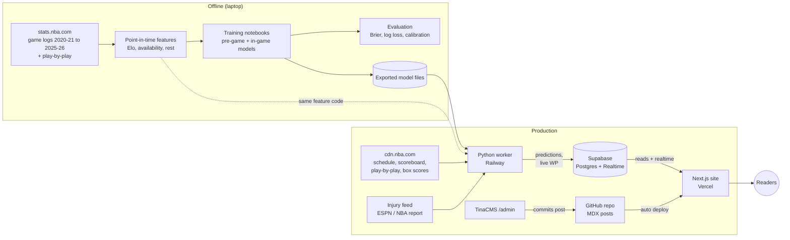

# TeeKay's Playbook

A basketball analytics site with live NBA win probabilities, pre-game predictions, and a blog for post-game analysis and research.

## Features

- **Homepage**: today's games, scores, team logos, and pre-game win probabilities.
- **Live win probability**: a pre-game prior updated with live play-by-play, shown as a chart that updates during the game.
- **Blog and research**: post-game reactions, strategy breakdowns, and model write-ups, published through TinaCMS.

## Architecture



### How the pieces fit

| Layer | Choice | Role |
|---|---|---|
| Frontend | Next.js on Vercel | Homepage, live game pages, blog |
| Blog | MDX + TinaCMS | Write at `/admin`; Tina commits to GitHub and Vercel redeploys |
| Database | Supabase (Postgres + Realtime) | Games, ratings, predictions, live probabilities |
| Worker | Python on Railway | Daily pre-game predictions; live play-by-play polling during games |
| Models | pandas, scikit-learn | Trained offline, loaded by the worker |
| Charts | Recharts | Live win probability chart |

### Data sources

- **Production** uses only `cdn.nba.com` endpoints, which are reachable from cloud servers.
- **`stats.nba.com`** blocks most cloud IPs, so it is only used locally to pull historical training data.
- **Injury and availability** comes from the ESPN injuries feed, with the official NBA injury report as a fallback.

## Models

**Pre-game model.** Logistic regression predicting P(home team wins) for regular-season games. Features, all built only from games before tip-off:

- **Elo rating gap** (team strength, with season carryover)
- **Availability**: share of each team's usual minutes that are out tonight (box scores in training, injury report in production)
- **Rest**: home and away back-to-back flags, plus a 3-games-in-4-nights flag

Home-court advantage is the intercept. Seasons 2020-21 and 2021-22 warm up Elo; 2022-23 and 2023-24 train; 2024-25 validates every design choice; 2025-26 is a one-time final test. Calibration is the top priority. Full design and reasoning: [`docs/pregame-model.md`](docs/pregame-model.md).

**In-game model.** Score margin, seconds remaining, possession, the pre-game probability as a prior, and margin divided by the square root of time remaining. Trained on 3 to 5 seasons of play-by-play and evaluated with Brier score and calibration plots.

## Repository layout

```
teekays-playbook/
├── web/       Next.js site, TinaCMS, blog posts (MDX)
├── worker/    Python worker: daily predictions + live polling
├── models/    Offline data pulls, training notebooks, exported models
└── docs/      Architecture and design notes
```

## Build phases

0. **Models (offline)**: pull history, build the availability feature, train and validate both models.
1. **Site skeleton**: homepage with games and logos, blog with TinaCMS, deploy to Vercel.
2. **Pre-game predictions**: daily job writes predictions; site displays them.
3. **Live win probability**: worker polls play-by-play; live chart updates.
4. **Model accuracy tracker**.
5. **Accounts and comments**.

## Costs

About $5 USD/month for the worker during the season, plus an optional domain. Everything else runs on free tiers.

## Disclaimer

Non-commercial fan project. Not affiliated with or endorsed by the NBA. Team names and logos are trademarks of the NBA and its teams.
