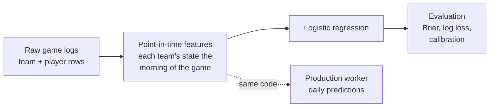

# Pre-game win probability model

This document explains how TeeKay's Playbook predicts each team's chance of winning **before tip-off**, and why each design decision was made. It is the spec the training notebook and the production worker both follow.

Status: design complete, not yet built.

---

## 1. What the model predicts

- **One row per regular-season game.**
- **Label:** did the home team win? (1 or 0)
- **Output:** P(home team wins). The away team's probability is 1 minus that.

Everything is framed from the home team's side so every game is oriented the same way.

**Scope: regular season only.** Playoff basketball behaves differently: rotations shorten, stars play more minutes, and teams game-plan for one opponent across a series. The 2023 Heat reaching the Finals as an 8 seed is the kind of result a regular-season model should not be expected to see coming. Playoff predictions would need their own adjustment later.

## 2. Pipeline

The feature-building step is the same code the production worker runs every morning. If training features and production features were built differently, the model would learn one thing and be fed another (train/serve skew).

## 3. Model form

Logistic regression on **home minus away** differences, plus separate home/away flags where the effect may not be symmetric.

- With differences, one coefficient answers "how much does an edge in X matter", instead of separate home and away coefficients.
- **Home-court advantage lives in the intercept**: if both teams are identical on every feature, the model returns the home-court baseline.
- Logistic regression comes first because every coefficient is interpretable and can be explained in a blog post. Gradient boosting may be tried later.

## 4. How a feature earns its place

Every candidate feature must pass four tests:

1. **Basketball reason.** We start from a claim ("tired teams lose more"), not from every available column.
2. **No lookahead.** Built only from games *before* tip-off. A game on January 10 only sees games through January 9.
3. **Same in production.** Computable the same way on the live site as in training.
4. **Helps on unseen games.** Added one at a time; kept only if it improves validation scores (see section 8) and its coefficient has the sign we'd expect.

## 5. Features

### 5.1 Team strength: Elo

**Decision:** Elo, chosen over net rating.

**Why:** net rating (point margin per 100 possessions) is very noisy early in the season. Elo is stable from opening night, updates after every game, and its season-to-season carryover already handles blending this season with last season. Net rating may be tested later as an add-on, but the two are highly correlated, which makes logistic regression coefficients unstable if both are included.

**How it works.** Every team starts at 1500.

Expected result before a game:

$$E_{home} = \frac{1}{1 + 10^{-(R_{home} + H - R_{away})/400}}$$

Update after the game (result = 1 for a win, 0 for a loss):

$$R_{new} = R_{old} + K \times (\text{result} - E)$$

Opponent strength is built in through E: beating a strong team moves a rating a lot, beating a weak team barely moves it. Updates are zero-sum.

**Settings:**

| Setting | Meaning | Candidates | Notes |
|---|---|---|---|
| K | How fast ratings react to one game | 15, 20, 30 | Lean moderate-to-low: an 82-game season gives plenty of signal, so no single game should move a rating much |
| H | Home bonus inside Elo | 50, 75, 100 | Used only to make Elo updates fair. The model feature is the raw rating gap (no H); the regression intercept learns home court, so it is not counted twice |
| C | Season carryover | 0.5, 0.75, 1.0 | At the start of each season, ratings regress toward the mean: R_start = 1500 + C × (R_end − 1500). Reflects trades, free agency, the draft, aging |

**Warm-up seasons.** Elo needs time to settle. 2020-21 and 2021-22 are pulled only so ratings are meaningful by October 2022; the model never trains on them. (2020-21 also had few or no fans, so home court was atypical, another reason to keep it out of training.)

**Tuning.** Elo makes its own sequential pre-game predictions using only past games, so K, H and C are narrowed using Elo's own Brier score on the training seasons. Only the finalists are compared on the validation season.

**Deferred to v2:**
- Margin-of-victory multiplier (blowouts count more, with diminishing returns).
- Roster-continuity carryover: carryover weighted by how much of last season's minutes return, plus incoming talent. Motivating case: Boston's 2023 offseason (adding Porzingis and Holiday) before their 2024 title, where a flat carryover would have pulled an improved team toward average.

### 5.2 Availability (player impact, minutes-based)

**Decision:** a player's impact is measured by **minutes**. Minutes reflect how much the coach trusts a player, and coaches know their players better than any stat.

**Feature:**
1. Each player's average minutes over the team's last N games (games missed count as 0).
2. A team's "usual minutes" is the total across its rotation.
3. **Missing share** = share of usual minutes belonging to players who are out tonight.
4. Feature = home missing share − away missing share.

**Questionable players count as half available** (v1 assumption, to be checked later against how often questionable players actually play).

**Load management is credited to availability, not rest.** If a star sits on a back-to-back, the missing minutes show up here. This works in production too, because the injury report lists rest absences.

**Options tested on validation (9 combinations):**

| Window N | Long-absent players |
|---|---|
| Last 5 games | (a) Plain last-N average, so they fade to zero |
| Last 10 games | (b) Pre-injury minutes, so they always count (risk: double-counting, since Elo has already adjusted to the team playing without them) |
| Season-to-date | (c) Count for a period after going out, then fade |

**Known weaknesses:**
- On a bad team, a mediocre player can log heavy minutes because there is no one better. Elo partly covers this, since the team is already rated low.
- **Train/serve gap:** in training, availability comes from box scores (certain). In production, it comes from the injury report, which includes game-time decisions (uncertain). The model may be overconfident about injuries; watch for this in live calibration.

### 5.3 Rest and back-to-backs

**Rest days** = days between games minus 1 (0 = back-to-back). Season openers have no previous game and are treated as fully rested.

The schedule is published in advance, so rest has no lookahead risk and is computed identically in production.

**The effect is assumed non-linear:** 0 vs 1 day off matters far more than 2 vs 3, and a week off at the All-Star break doesn't make a team seven times fresher. A raw rest-days difference would wrongly treat every extra day as equally valuable.

**Separate home and away flags** (`home_b2b`, `away_b2b`) instead of a single difference, so each gets its own coefficient. Expected signs for P(home wins): `home_b2b` negative, `away_b2b` positive. Hypothesis to test later: fatigue matters more on the road, so `away_b2b` should be larger in magnitude.

**Options tested on validation:**

| Option | Features |
|---|---|
| (a) | `home_b2b`, `away_b2b` |
| (b) | Rest days capped at 3, home minus away |
| (c) | (a) plus a "3 games in 4 nights" flag for each team |

**Pre-registered bet: (c).** Note that every 3-in-4 stretch contains a back-to-back (three games can't fit into four days without two on consecutive days), so the 3-in-4 flag measures fatigue *on top of* the back-to-back.

**Interpretation:** because resting stars show up in availability, the back-to-back coefficient measures fatigue among the players who did play, not the total effect of a back-to-back.

**Possible check:** whether the back-to-back effect shifted after the NBA's Player Participation Policy (introduced for 2023-24), since the training seasons straddle it.

**Deferred to v2:** travel distance, time zones, road-trip length, second night of a road back-to-back.

## 6. Data

| Season | Role |
|---|---|
| 2020-21 | Elo warm-up only |
| 2021-22 | Elo warm-up only |
| 2022-23 | Train |
| 2023-24 | Train |
| 2024-25 | Validate (all feature and tuning decisions) |
| 2025-26 | Test (used once, at the end) |

Source: `stats.nba.com` `LeagueGameLog`, pulled locally (the site blocks cloud IPs). Two calls per season:
- **Team rows:** one row per team per game, for Elo, results and the schedule.
- **Player rows:** one row per player per game, for minutes and the availability feature.

The pre-game model does not need play-by-play; that pull is only for the in-game model.

## 7. Why train / validate / test

The data does three jobs, and each needs its own games:

- **Train** (2022-23, 2023-24): the model learns its coefficients here.
- **Validate** (2024-25): *we* make choices here, such as which features, which Elo settings, and which availability window. Choosing between options is a form of fitting too.
- **Test** (2025-26): the final exam, used exactly once. Its score is the one we report.

If we compared many options on the test season and kept the best, part of the winner's score would be luck specific to that season, and the reported score would be too optimistic. Like practising on the actual final exam.

**Split by season, never randomly.** A random split would let the model learn from March games to predict January games. On the live site we always predict the future, so evaluation does too.

After the final test, the model is retrained on all four modelling seasons with the chosen settings, and that is what ships.

## 8. Evaluation

### Metrics

**Brier score** (primary): the average squared gap between the predicted probability and the result.

$$\text{Brier} = \frac{1}{n}\sum (p_i - y_i)^2$$

- Lower is better. Always predicting 50% scores 0.25.
- It is a *proper scoring rule*: the best expected score comes from reporting the true probability, so it rewards honest forecasts and punishes both overconfidence and hedging.
- There is a floor well above 0: even a perfect model of a true 70/30 game scores 0.21 on average for that game, because basketball is random. Realistic models land in a narrow band between about 0.21 and 0.25.

**Log loss:** same idea, but punishes confident misses much more harshly. It is our overconfidence alarm, and it is what logistic regression optimises in training.

**Calibration plot:** when we say 70%, do those teams win about 70% of the time?

### Priority: calibration

Readers should be able to take the numbers at face value. Calibration is the **requirement**; resolution (actually telling games apart) is the **goal** within it. A model that says 55% for every game is perfectly calibrated and useless. The calibration chart may be published on the site as part of the Phase 4 accuracy tracker.

### Baselines to beat

1. **Home baseline:** every game predicted at the historical home win rate. If home teams win about 55%, this scores about 0.2475: well calibrated, zero resolution.
2. **Record baseline:** the team with the better record is favoured.

### Deciding between options: the clear-margin rule

Differences between models will be small, so they are judged against noise, not against the size of the scale. One game flipping from a 0.09 penalty to a 0.49 penalty moves average Brier over 1,230 games by about 0.0003, so a 0.001 gap is roughly three games going the other way.

**Rule:** resample the validation games with replacement a few thousand times (bootstrap) and recompute each option's score. An option must win in about 95% of resamples to be chosen; otherwise keep the simpler one. Before accepting a winner, also check:
- its calibration plot (not overconfident at the extremes),
- train/serve parity,
- that the win makes basketball sense.

## 9. v2 backlog

- Margin-of-victory Elo
- Roster-continuity carryover
- Net rating as an add-on to Elo
- Travel, time zones, road-trip length
- Home vs road fatigue asymmetry (deeper study)
- Questionable-player weight calibrated from history
- Playoff adjustment
- Gradient boosting
